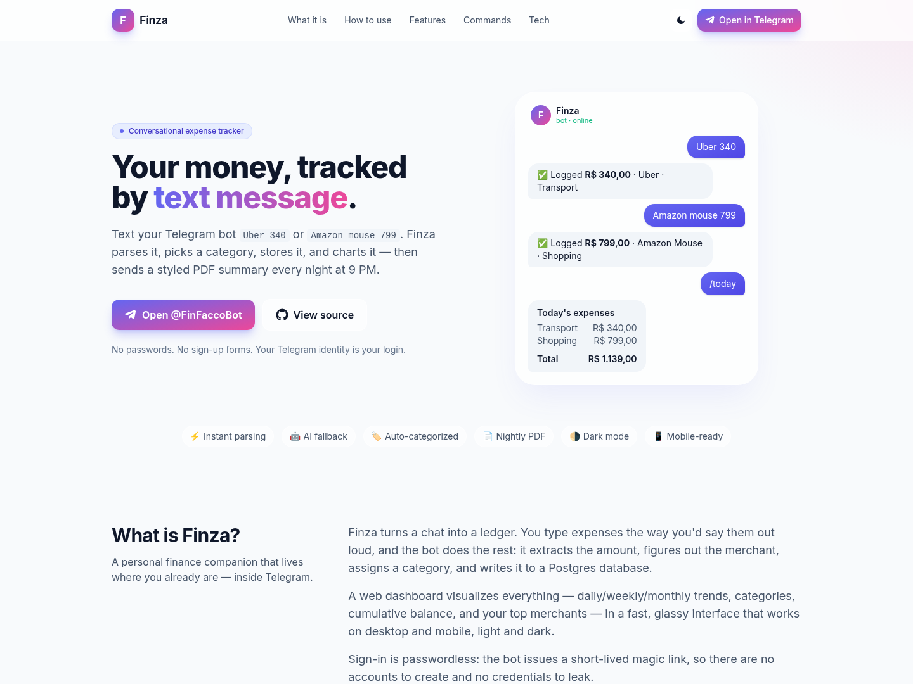

<div align="center">

# 💸 Finza

**Track your money by texting your Telegram bot.**

Send `Uber 340` or `Amazon mouse 799` and Finza parses the amount, picks a category,
stores it, charts it — then pushes a styled PDF summary every night at 9 PM.


[**Live demo**](https://financas.sfacco.com.br) ·
[**Open the bot**](https://t.me/FinFaccoBot) ·
[**Source**](https://github.com/DiovaniFacco/finza-telegram)



</div>

---

## What is Finza?

Finza is a **conversational personal-finance tracker**. Instead of filling out forms, you text a
Telegram bot the way you'd talk — `almoço 42`, `Uber 340`, `recebi 5000 salário` — and it turns that
into structured financial data.

Under the hood it's an async **FastAPI** service that runs a `python-telegram-bot` application in
webhook mode, parses each message through a cheap-to-expensive cascade (regex → rules → LLM), stores
everything in **PostgreSQL** (SQLAlchemy 2 async + Alembic), and renders a glassy, dark/light **web
dashboard** with Chart.js. A scheduled job ships a **styled PDF report** to every active user at 9 PM.

A web dashboard visualizes daily/weekly/monthly trends, categories, cumulative balance, wallet split
and top merchants — mobile-first and passwordless (the bot issues a short-lived **magic link**).

## Try it

- 🖥️ **Live dashboard:** [financas.sfacco.com.br](https://financas.sfacco.com.br) — no account; send
  `/dashboard` to the bot to receive a one-time magic link.
- 🤖 **Telegram bot:** [@FinFaccoBot](https://t.me/FinFaccoBot) — send `/start`, then text an expense.

## How it feels

```
You: Uber 340
Bot: ✅ Registrado R$ 340,00 · Uber · Transporte

You: Amazon mouse 799
Bot: ✅ Registrado R$ 799,00 · Amazon Mouse · Compras

You: /today
Bot: Gastos de hoje
     Transporte: R$ 340,00
     Compras:    R$ 799,00
     Total:      R$ 1.139,00
```

It also understands **voice notes** (Whisper) and **receipt photos** (vision OCR): send an audio or a
picture of a receipt and it extracts amount, merchant and category automatically.

## Features

**Capture**
- Natural-language parsing of amounts, merchants and categories (handles `R$ 1.000,50`, `1.000,50`, `340`).
- Voice messages transcribed with Groq Whisper.
- Receipt photos read with a vision model.

**Intelligence** — a three-stage cascade keeps latency low and AI cost near zero:
1. **Regex** extracts the amount.
2. **Rules** match merchant tokens against an in-code + DB-backed `category_rules` table.
3. **AI fallback** only when the first two fail — **Groq** (primary, free tier) → **OpenRouter** `:free` models, with a strict JSON schema.

**Money model**
- Expenses, **incomes** and **investments**, categorized in PT-BR (Alimentação, Transporte, Investimento…).
- Wallet split: **conta** (bank) vs **dinheiro** (cash), plus running balances.

**Reporting & dashboard**
- Web dashboard: category breakdown, daily/weekly/monthly series, cumulative balance, top merchants — dark/light, responsive.
- **Nightly PDF** (ReportLab + matplotlib) delivered to Telegram at 9 PM in the user's timezone.
- On-demand PDF/CSV export.

**Platform**
- Async FastAPI + SQLAlchemy 2, Alembic migrations run on deploy.
- Passwordless auth: 15-minute JWT magic link → 30-day signed, HttpOnly session cookie.
- Structured logging (`structlog`), health and webhook introspection endpoints.

## Tech stack

| Layer | Choice |
| --- | --- |
| Language | Python 3.12 |
| Web / API | FastAPI + Uvicorn |
| Bot | `python-telegram-bot` v21 (webhook mode) |
| Database | PostgreSQL + SQLAlchemy 2 (async) + Alembic |
| AI | Groq (primary) → OpenRouter `:free` (fallback) — text, Whisper, vision |
| Reporting | ReportLab + matplotlib (no system deps) |
| Frontend | Jinja2 + TailwindCSS (CDN) + Chart.js |
| Scheduling | APScheduler |
| Auth | PyJWT magic links + `itsdangerous` signed cookies |
| Hosting | Railway (app) + Supabase (Postgres) |

## Architecture

```
                 Telegram
                    │  (webhook: POST /webhook/<secret>)
                    ▼
        ┌───────────────────────────┐
        │            Finza           │
        │        (FastAPI app)       │
        ├───────────────────────────┤
        │  routes/webhook  → PTB app │  ← command + text/voice/photo handlers
        │  services/parser → rules   │
        │  services/ai  ── Groq ─┐   │
        │      └──────── OpenRouter ┘│
        │  routes/dashboard (Jinja)  │  ← magic-link auth, charts, exports
        │  scheduler/daily  (9 PM)   │  ← PDF reports
        └─────────────┬─────────────┘
                      ▼
               PostgreSQL (Supabase)
```

```
app/
├── main.py            # FastAPI app + lifespan (PTB + APScheduler)
├── config.py          # Pydantic settings
├── routes/            # webhook, auth (magic link), dashboard, exports
├── bot/               # handlers (commands, text, voice, photo) + application builder
├── services/          # parser, categorizer, ai, openrouter, media, report, charts, auth
├── db/                # async engine, repository, SSL config
├── models/            # SQLAlchemy models
├── migrations/        # Alembic env + versions
├── scheduler/         # nightly 9 PM job
├── templates/         # landing, overview, charts, expenses, reports
├── static/            # app.js (theme + currency formatting)
└── utils/             # logging, money, request helpers
```

## Bot commands

| Command | Description |
| --- | --- |
| `/start` | Onboard and register the user |
| `/today` | Today's totals + per-category breakdown |
| `/month` | Current calendar month summary |
| `/export` | Styled PDF for the current month |
| `/saldo` | Wallet balances (conta / dinheiro / invested) |
| `/dashboard` | Issue a magic link to the web dashboard |
| `/help` | Usage examples |
| _free text_ | Parsed as an expense / income / investment |
| _voice / photo_ | Transcribed or read, then parsed |

## Data model

- `users(id, telegram_id, username, first_name, created_at, updated_at)`
- `expenses(id, user_id, merchant, amount, category, kind, notes, expense_date, wallet, created_at)` — indexed on `(user_id, expense_date)` and `(user_id, category)`
- `category_rules(id, keyword, category)` — seeded with PT-BR rules
- `daily_reports(id, user_id, report_date, total_amount, pdf_path, created_at)` — unique on `(user_id, report_date)`

`kind ∈ {expense, income, investment}`; `wallet ∈ {conta, dinheiro}`, plus an initial balance.

## Getting started

### Prerequisites

- Python 3.12+
- PostgreSQL 14+ (local, Docker, or a free Supabase project)
- A Telegram bot token from [@BotFather](https://t.me/BotFather)
- (Optional) A [Groq](https://console.groq.com/) key for AI parsing/voice/vision, and/or an [OpenRouter](https://openrouter.ai/) key for the fallback

### 1. Install

```bash
python -m venv .venv && source .venv/bin/activate
pip install -e .
```

### 2. Configure

```bash
cp .env.example .env   # then edit .env
```

### 3. Migrate

```bash
alembic upgrade head
```

### 4. Run

```bash
uvicorn app.main:app --reload
```

For a local Telegram webhook, expose the port (`ngrok http 8000`) and set `APP_URL` to the ngrok URL —
the app registers the webhook on startup. Visiting `/` while logged out shows the landing page; the
dashboard itself opens through the `/dashboard` magic link.

## Environment variables

| Variable | Required | Notes |
| --- | --- | --- |
| `TELEGRAM_BOT_TOKEN` | yes | From @BotFather |
| `DATABASE_URL` | yes | Postgres URI; auto-converted to `postgresql+asyncpg://` |
| `SECRET_KEY` | yes | Signs JWT magic tokens + session cookies |
| `APP_URL` | recommended | Public base URL for webhook + magic links (auto-set on Railway) |
| `WEBHOOK_SECRET` | recommended | Secret path segment for `/webhook/<secret>` |
| `GROQ_API_KEY` | no | AI parsing, Whisper voice, receipt vision |
| `OPENROUTER_API_KEY` | no | Fallback AI provider |
| `APP_TZ` | no | Timezone for "today" and the 9 PM job (default `America/Sao_Paulo`) |
| `TELEGRAM_BOT_USERNAME` | no | Bot handle shown on the landing page |
| `GITHUB_REPO_URL` | no | Repo link shown on the landing page |
| `LOG_LEVEL` | no | Logging verbosity (default `INFO`) |

## Deployment

Targets **Railway** (app) + **Supabase** (Postgres). `railway.json` wires the start command to run
migrations then boot Uvicorn, with `/healthz` as the healthcheck. See [DEPLOYMENT.md](DEPLOYMENT.md)
for the full checklist and [SETUP.md](SETUP.md) for a step-by-step local guide.

## Security

- The webhook lives behind a secret path segment (`/webhook/<WEBHOOK_SECRET>`) — defense in depth.
- Magic links are short-lived JWTs (15 min) signed with `SECRET_KEY`.
- Session cookies are HMAC-signed (`itsdangerous`), `HttpOnly`, and `Secure` on HTTPS.
- Every dashboard query is scoped to the authenticated `user_id` — no cross-user reads.
- No credentials in the repo: everything comes from environment variables.

## License

Released under the **MIT License** — see [LICENSE](LICENSE).
